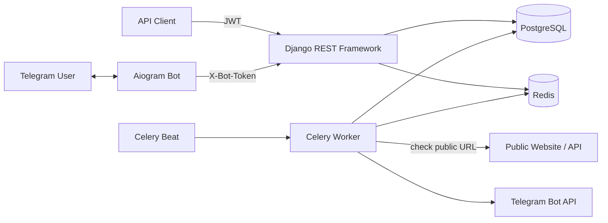

# StatusPulse

**StatusPulse** is a website and API uptime monitoring service with a Django REST Framework API, a Telegram bot, scheduled background checks, incident history, and Telegram alerts.

> Portfolio project. Before exposing a public instance, rotate all secrets, use HTTPS, restrict outbound traffic at the network layer, and review the security notes below.

## Features

- JWT authentication and account registration.
- Create, update, pause, and delete monitors.
- Configurable check intervals (1, 5, 10, 30, or 60 minutes), timeouts, and optional expected HTTP status codes.
- Check history with status, HTTP code, response time, and error category.
- Automatic incident creation when a monitored endpoint goes down, and incident resolution after recovery.
- Uptime percentage and average response-time statistics for periods from 1 to 90 days.
- Telegram account linking with one-time, short-lived codes.
- Telegram commands: `/status`, `/incidents`, `/link CODE`, `/help`.
- Celery worker and Celery Beat for background work; Redis for the broker and result backend.
- Docker Compose stack: API, PostgreSQL, Redis, worker, scheduler, and bot.
- OpenAPI schema and Swagger UI.
- Tests for authentication, account isolation, monitoring API behavior, URL validation, Telegram linking, and check results.

## Architecture



- **Django REST Framework** owns authentication, authorization, database access, API validation, and business logic.
- **Aiogram** is a separate interface. It calls protected internal endpoints and does not connect directly to PostgreSQL.
- **Celery Beat** dispatches scheduled checks; **Celery workers** run HTTP checks and queue notification delivery.
- **PostgreSQL** stores accounts, monitors, check results, Telegram links, and incidents.
- **Redis** provides Celery's broker and result backend.

## Quick start

### 1. Configure environment

```bash
cp .env.example .env
```

Edit `.env`. At minimum, set `DJANGO_SECRET_KEY`, `POSTGRES_PASSWORD`, and `BOT_INTERNAL_TOKEN` to long random values. To use Telegram commands and notifications, also set `TELEGRAM_BOT_TOKEN` using a token created with [@BotFather](https://t.me/BotFather).

For a quick local development run, `DJANGO_DEBUG=1` is set in `.env.example`. Do not use debug mode in a public deployment.

### 2. Build and start the stack

```bash
docker compose up --build -d
docker compose ps
```

The API container applies database migrations before starting Gunicorn. View logs with:

```bash
docker compose logs -f api worker beat bot
```

API base URL: <http://localhost:8000>

Swagger UI: <http://localhost:8000/api/docs/>
OpenAPI schema: <http://localhost:8000/api/schema/>
Health check: <http://localhost:8000/health/>

Create an admin user when needed:

```bash
docker compose exec api python manage.py createsuperuser
```

### 3. Register and get an access token

Register an account:

```bash
curl -X POST http://localhost:8000/api/v1/auth/register/ \
  -H 'Content-Type: application/json' \
  -d '{"username":"demo","email":"demo@example.com","password":"ChangeThisPassword123!","password_confirm":"ChangeThisPassword123!"}'
```

Get a JWT pair (the token endpoint authenticates with username and password):

```bash
curl -X POST http://localhost:8000/api/v1/auth/token/ \
  -H 'Content-Type: application/json' \
  -d '{"username":"demo","password":"ChangeThisPassword123!"}'
```

Copy the `access` value. The examples below use `$ACCESS_TOKEN` in the shell:

```bash
export ACCESS_TOKEN='paste-access-token-here'
```

### 4. Add a monitor

```bash
curl -X POST http://localhost:8000/api/v1/monitors/ \
  -H "Authorization: Bearer $ACCESS_TOKEN" \
  -H 'Content-Type: application/json' \
  -d '{"name":"Example health endpoint","url":"https://example.com/","interval_seconds":300,"timeout_seconds":10}'
```

The first check is scheduled promptly. The dispatcher runs every minute, so execution is periodic rather than instantaneous. You can list, update, pause, and delete monitors using `GET`, `PATCH`, and `DELETE` on `/api/v1/monitors/` and `/api/v1/monitors/{id}/`.

### 5. Read check history, stats, and incidents

```bash
# List your monitors
curl http://localhost:8000/api/v1/monitors/ -H "Authorization: Bearer $ACCESS_TOKEN"

# Check history for monitor 1
curl 'http://localhost:8000/api/v1/monitors/1/checks/' -H "Authorization: Bearer $ACCESS_TOKEN"

# Seven-day stats
curl 'http://localhost:8000/api/v1/monitors/1/stats/?days=7' -H "Authorization: Bearer $ACCESS_TOKEN"

# Open incidents
curl 'http://localhost:8000/api/v1/incidents/?state=open' -H "Authorization: Bearer $ACCESS_TOKEN"
```

### 6. Link Telegram

The link-code endpoint requires an access token:

```bash
curl -X POST http://localhost:8000/api/v1/telegram/link-code/ \
  -H "Authorization: Bearer $ACCESS_TOKEN"
```

Open your bot in Telegram and send `/link CODE` using the code returned by the endpoint. Codes expire after 10 minutes and can only be used once. Then use `/status` and `/incidents` in the private chat.

If you change the bot token or internal token in `.env`, restart affected services:

```bash
docker compose up -d --build api worker beat bot
```

## API endpoints

| Method | Endpoint | Purpose |
|---|---|---|
| `POST` | `/api/v1/auth/register/` | Create an account |
| `POST` | `/api/v1/auth/token/` | Obtain JWT tokens |
| `POST` | `/api/v1/auth/token/refresh/` | Refresh an access token |
| `GET, POST` | `/api/v1/monitors/` | List/create the current user's monitors |
| `GET, PATCH, DELETE` | `/api/v1/monitors/{id}/` | Retrieve/update/delete one owned monitor |
| `GET` | `/api/v1/monitors/{id}/checks/` | Paginated check history; optional `?status=up` or `?status=down` |
| `GET` | `/api/v1/monitors/{id}/stats/?days=7` | Uptime and response-time statistics |
| `GET` | `/api/v1/incidents/` | List incidents; optional `?state=open` and `?monitor={id}` |
| `POST` | `/api/v1/telegram/link-code/` | Generate a short-lived link code |
| `GET` | `/api/docs/` | Swagger UI |

Internal bot endpoints under `/api/v1/telegram/bot/` require the shared `X-Bot-Token` and should not be exposed as a separate public integration. User-owned records are filtered on the server; the bot cannot choose an arbitrary account ID.

## Run tests

With the Docker stack running:

```bash
docker compose exec api python manage.py test
```

To run the Django tests locally with an in-memory SQLite database (useful for quick unit tests; deployment still uses PostgreSQL):

```bash
python -m venv .venv
source .venv/bin/activate
pip install -r requirements.txt
DJANGO_TESTING=1 python manage.py test
```

## Data model

- `User` — Django authentication user.
- `Monitor` — URL and schedule owned by one user, plus last known status.
- `CheckResult` — append-only result of one HTTP check.
- `Incident` — an outage interval, resolved when checks recover.
- `TelegramConnection` — one private Telegram chat connected to one user.
- `TelegramLinkCode` — single-use linking code with an expiry timestamp.

## Operational notes and next steps

1. Add a retention policy for old `CheckResult` rows before monitoring a large number of endpoints.
2. Add metrics and structured logs for worker queue latency, failures, and check execution time.
3. Move outbound URL checks behind a network egress policy or a dedicated checker service. URL validation and disabled redirects help, but are not a substitute for network isolation against DNS rebinding and other SSRF techniques.
4. Configure HTTPS, secure cookies if session-based authentication is added, proper allowed hosts, backups, monitoring, and secret rotation before public deployment.
5. Add integration tests against PostgreSQL and Redis to complement the fast unit tests.

## License

MIT — see `LICENSE`.
